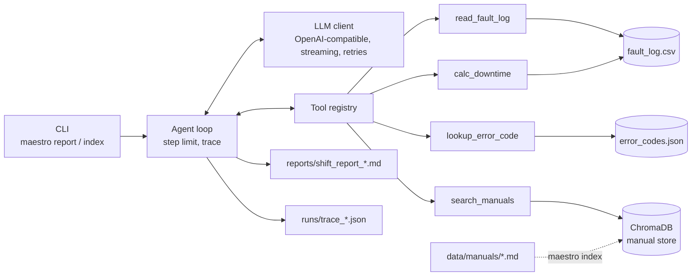
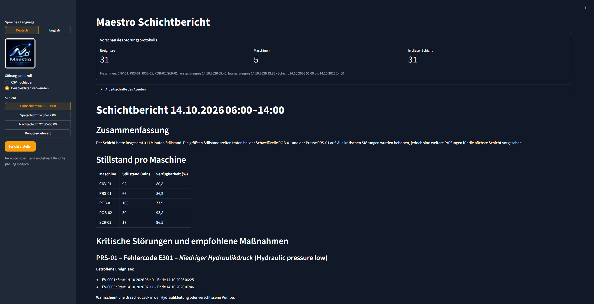

<p align="center">
  
</p>

<h1 align="center">Maestro Agent</h1>

<p align="center">An AI agent that reads machine fault logs, searches maintenance manuals and writes a verified shift report in English or German.</p>

<p align="center">
  <a href="https://github.com/abdulrahim-ramadan/maestro-agent/actions/workflows/ci.yml"></a>
  
  <a href="LICENSE"></a>
</p>

## What it does

- Reads the fault log of a production shift and calculates downtime and availability per machine.
- Looks up every error code and searches the maintenance manuals (RAG) for the matching repair steps.
- Writes a Markdown shift report: summary, downtime table, critical issues with cited manual actions, open points.
- Shows every agent step live in the terminal and saves a JSON trace of each run.

## Demo

A real report produced by `maestro report --lang en`: [examples/sample_report_en.md](examples/sample_report_en.md)

## Architecture



## Tech Stack

| Technology | Why |
|---|---|
| Python 3.11+ | Dataclasses, enums and type hints keep the domain model explicit. |
| OpenAI Python SDK | One client for any OpenAI-compatible API; the provider is a `.env` setting. |
| Groq with `openai/gpt-oss-120b` | Fast tool calling on a free tier. |
| ChromaDB | Embedded, persistent vector store with local default embeddings; no server to run. |
| rich | Live step view, streamed report and summary table in the terminal. |
| pytest | Unit tests with fake LLM clients, so the suite runs without API calls. |
| GitHub Actions | Runs the tests on Python 3.11 and 3.12 for every push and pull request. |

## Design decisions

**Dictionary for exact codes, RAG for long manuals.** Error codes are exact keys, so `lookup_error_code` reads them from a JSON dictionary: no embedding can beat an exact match. Manuals are long free text, so they are chunked by heading and searched semantically in ChromaDB.

**Every number comes from a tool.** Downtime, availability and event IDs are computed in Python and only copied by the model. The prompt forbids own arithmetic, and `tests/test_report_numbers.py` checks the sample report against `calc_downtime` and `read_fault_log`.

**Tools accept batches.** The model calls one tool per step, so `lookup_error_code` takes a list of codes. `search_manuals` accepts up to 5 queries per call and returns the best matching manual section for each. All codes or all queries fit into one step instead of one step each.

**Errors never stop a run.** A failing tool returns an error result the model can react to. A failing display callback is logged as a warning event and the run continues.

**Step limit and a trace for every run.** The agent stops after a fixed number of steps. Every run, including a failed one, writes a JSON trace with each step, tool call and result.

## Lessons learned

- **Invented total.** A German report claimed 321 minutes of total downtime; the real sum is 311 and no tool returned a total. The prompt now forbids own arithmetic, and a test checks every number in the sample report.
- **Mixed up event IDs.** The model put event IDs under the wrong issue or garbled them (EV-0090 instead of EV-0009). `read_fault_log` now returns the critical event IDs grouped per machine and error code, so the model copies a ready list.
- **The 8,000 token limit.** Groq's free tier rejects requests above 8,000 tokens per minute, and the batched tool results were bigger. Tool output is now compact: fault log rows instead of objects, only the best manual section per query, no repeated sections.
- **Outdated model documentation.** A model name from the provider documentation returned a 404. `scripts/list_models.py` asks the endpoint which models really exist.

## Quick Start

```bash
git clone https://github.com/abdulrahim-ramadan/maestro-agent.git
cd maestro-agent
python -m venv .venv
source .venv/bin/activate        # Windows: .venv\Scripts\activate
pip install -e ".[dev]"
cp .env.example .env             # then set LLM_API_KEY
maestro index
maestro report --lang en
```

Options: `--lang en|de`, `--log <csv>`, `--out <dir>`, `--shift-start HH:MM`, `--shift-end HH:MM`.

## Web interface

```bash
pip install -e ".[ui]"
maestro ui
```

A bilingual Streamlit page, German by default: the "Sprache / Language" toggle at the top of the sidebar switches the whole interface and the report language between Deutsch and English. It offers fault log upload (or the sample data) and shift presets. It shows the agent steps live, streams the report, then renders it with a downtime chart and a download button. Each report uses about 35k tokens of the provider's daily quota.



[Demo video (sped up)](docs/maestro-demo.mp4)

## For shift leads

1. Double-click `start_maestro.bat` in the Maestro folder. Your browser opens Maestro after a few seconds; keep the black window open while you work.
2. Upload the fault log (CSV) in the sidebar.
3. Choose the shift and the language with the "Sprache / Language" toggle (German is the default).
4. Click **Generate report**, then read or download the report.

If the window shows an error, send its text to IT. The one-time setup is described under Quick Start and Web interface.

## Tests

```bash
pytest                  # all tests
pytest -m "not slow"    # skip tests that load the embedding model and the vector store
```

No test calls the LLM API.

## Roadmap

- Live machine data via OPC UA instead of CSV exports
- Web interface for shift leads
- Larger evaluation set of fault logs with expected reports

## Author

**Abdulrahim Ramadan**: [GitHub](https://github.com/abdulrahim-ramadan) · [LinkedIn](https://www.linkedin.com/in/abdulrahim-ramadan-3983b6299) · [abdulrahim-ramadan.com](https://abdulrahim-ramadan.com)

Licensed under the [MIT License](LICENSE).
